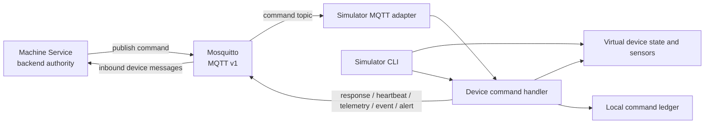

# ScentStation Virtual IoT Device Simulator — Research & Design

**Task:** Epic 3 — Device Simulator & Physical Kiosk Prototype / Research & Design IoT Device Simulator  
**Status:** Design baseline for review; simulator implementation is a later task.  
**Repository baseline:** working tree inspected 2026-11-21. Existing uncommitted IoT changes were treated as input and preserved.

## 1. Purpose and scope

Define a Java virtual device that behaves like the device side of the ScentStation MQTT contract. It will let the Machine Service integration be exercised without claiming that physical ESP32 hardware exists. The simulator owns only its local emulated hardware state. Machine Service remains the backend boundary for device communication and the only component that can access backend databases.

This task establishes architecture and verifiable design decisions. It does not implement the simulator, MQTT application adapter, sensor behavior, or hardware prototype.

## 2. Repository findings

- `contracts/mqtt/v1.md` defines MQTT v1: MQTT 3.1.1, QoS 1, six topic types, JSON envelope, timestamps, IDs, duplicate handling, and no retained messages.
- `infra/mosquitto/` and root `docker-compose.yml` configure the local broker, credential setup, and per-device ACLs. Machine Service now connects to the broker, publishes commands, and processes authenticated device messages.
- `device/simulator/` and `device/firmware/` are reserved directories with no implementation.
- Machine Service already has `Machine` (`id`, `serialNumber`, `deviceIdentity`, status, `lastSeenAt`), `MachineSlot` (`id`, `productId`, `doseMl`, calibrated duration and status), and `MachineCommand` (`commandId`, `machineId`, `slotId`, expiry and result state).
- Backend machine states are `ONLINE`, `OFFLINE`, `UNSTABLE`, `DISABLED`, `MAINTENANCE`, and `ERROR`; slot states are `AVAILABLE`, `EMPTY`, `DISABLED`, and `ERROR`. Simulator runtime states such as `IDLE`, `BUSY`, and `DISPENSING` are local detail and must not expand or impersonate those backend enums.
- The current command entity has no measured dispense volume. MQTT v1 does not transmit a measured volume; `doseMl` is configured on a slot. Exact inventory accounting therefore remains a backend/service contract decision for its dedicated task.
- Order-dispense commands now persist their registered `deviceIdentity`; inbound command responses are checked against the machine and command identity.

## 3. Architecture decision

Build `device/simulator` as a standalone Java 21 application, using a small MQTT client adapter (Eclipse Paho MQTT client is the proposed library) and a CLI for local operation. Keep transport and device behavior behind interfaces so the MQTT implementation can later be replaced by an ESP32 MQTT client without changing Machine Service business rules.

The simulator has four internal areas:

1. **Device domain:** machine identity, local operating mode, configured slots, simulated consumable quantity, sensor/fault values, and actuator result.
2. **Command application:** validates protocol and target, checks expiry and safety preconditions, deduplicates `commandId`, runs one simulated dispense, and selects exactly one result.
3. **MQTT adapter:** connects as the configured device identity, subscribes only to that machine's command topic, publishes the five device-to-backend message types, and reconnects without replaying dispense commands.
4. **CLI/configuration:** starts/stops the process, selects configured machine, connects/disconnects, inspects state/sensors, changes simulated quantity, injects/clears faults, invokes emergency stop, and displays received commands and emitted results.

Use a `DeviceTransport` boundary and a `DeviceHardware` boundary. The simulator provides MQTT and virtual hardware implementations. Future firmware provides MQTT and physical GPIO/sensor/actuator implementations of the same behavioral ports; it must not require a simulator-specific backend protocol.

## 4. Identity and configuration

| Value | Source / meaning | Example |
|---|---|---|
| `machineId` | `Machine.id`, serialized as canonical decimal string; topic and envelope routing key | `"9101"` |
| `serialNumber` | Human-readable asset label; not a topic segment or MQTT username | `SS-DEMO-9101` |
| `deviceIdentity` | Registered `Machine.deviceIdentity`; MQTT username and ACL identity | `device-ss-demo-9101` |
| `slotId` | `MachineSlot.id`, serialized as canonical decimal string and checked against the machine | `"91001"` |
| `productId` | Slot's configured perfume reference for display/simulation only | `perfume-…` |

Supply broker URI, machine ID, device identity, and device password via command-line options or environment variables. Never commit credentials or put them in source/default config. Do not accept a user-supplied identity in a message as proof of identity: broker authentication/ACL plus Machine Service identity-to-machine validation are authoritative. Do not connect the simulator to MySQL or any backend database.

Initial local values for quantity, sensor readings, and fault injection are simulator configuration, not claims about physical stock. Runtime state must clearly label those values as simulated. The backend remains authoritative for slot configuration and inventory records.

## 5. MQTT contract behavior

The simulator must follow `contracts/mqtt/v1.md` exactly; this design does not define a parallel protocol.

| Direction | Topic suffix | Message type | QoS |
|---|---|---|---:|
| Backend → device | `command` | `DISPENSE_COMMAND` | 1 |
| Device → backend | `response` | `COMMAND_RESPONSE` | 1 |
| Device → backend | `heartbeat` | `HEARTBEAT` | 1 |
| Device → backend | `telemetry` | `TELEMETRY` | 1 |
| Device → backend | `event` | `DEVICE_EVENT` | 1 |
| Device → backend | `alert` | `DEVICE_ALERT` | 1 |

For each machine, derive topics from `scentstation/{machineId}/…`. Use the shared envelope (`schemaVersion`, `messageId`, `machineId`, `type`, UTC RFC 3339 `timestamp`, `payload`), never retained messages, and preserve a message ID if retrying a non-actuating publication. Heartbeat interval and offline threshold use the contract's initial 5-second and 15-second recommendations as configurable defaults.

The device-side command handler validates schema/type, machine and slot target, `commandId`, and expiry before considering actuation. It rejects or reports invalid/expired commands according to the contract. A duplicate `commandId` returns its previously recorded outcome and never runs the actuator again. Record command identity and execution state durably before an actuator action where the hardware boundary permits; after a restart with an uncertain physical outcome, return/report `UNKNOWN` and do not automatically execute again. QoS 1 redelivery is expected and is not permission to spray twice.

## 6. Virtual state and safety model

Keep local runtime state separate from backend status:

- Local lifecycle: `STOPPED`, `CONNECTING`, `CONNECTED`, `DISCONNECTED`.
- Local operation: `IDLE`, `BUSY`, `DISPENSING`, `MAINTENANCE`, `ERROR`.
- Backend-facing status mapping is limited to values supported by `MachineOperationalStatus`; never publish a made-up status enum.
- A slot simulation contains slot ID, product reference, enabled/available flag, configured dose or duration, and simulated remaining quantity. It is not a replacement for `MachineSlot` or inventory storage.

Before a simulated dispense, require all applicable checks to pass: valid command, matching machine/slot, unexpired command, no prior execution, machine idle and enabled, slot enabled and available, sufficient simulated quantity, healthy required sensors, closed door, no leak or pump fault, no emergency stop, and no maintenance mode. Execute only the requested slot and one calibrated cycle. Report the command result on `response`; use `event` for lifecycle/diagnostic events and `alert` for fault conditions, not as a second source of dispense outcome.

Model at least these injectable conditions: empty/low simulated perfume, sensor failure, pump failure, open door, abnormal temperature, leak, emergency stop, maintenance mode, network disconnect, and success. Critical faults stop the virtual actuator immediately. Clearing a fault must be an explicit CLI action. On disconnect during an actuation, do not retry: retain an uncertain result and reconcile by command ID when communication returns.

These software controls do not establish safety of a physical pump. Real perfume may be flammable; physical prototype work must separately assess ignition and material compatibility, and its emergency stop must cut actuator power through an independent hardware path.

## 7. Observability and operator controls

CLI output should show machine ID and device identity (never the password), connection state, local operating state, slot/product/quantity, sensor and fault values, latest command ID/result, and the last MQTT error. Logs must be structured enough to correlate `messageId` and `commandId`; credentials and sensitive backend/payment data must never be logged. CLI commands must allow start/stop, connect/disconnect, status, sensor/quantity changes, fault injection/clear, emergency stop, and command/result inspection.

## 8. Task boundaries and dependencies

This design task depends on the MQTT v1 contract and current machine/slot/command model. Broker ACLs, live Machine Service messaging, telemetry persistence, and offline detection are implemented. Real inventory deduction and hardware remain outside this simulator design and require their own work.

Follow-on implementation sequence should retain the 17 Jira issue names and use the requested order. The next work is MQTT communication/device authentication in Machine Service, followed by the Java simulator application and its backend communication. Simulator fault/dispense behavior follows those foundations. The separate inventory-consumption task must define authoritative dose and idempotent persistence; this simulator design does not invent a new MQTT volume field. Physical kiosk build/assembly remains explicitly unstarted until hardware is available.

## 9. Acceptance criteria for this design task

| Acceptance criterion | Evidence in this document |
|---|---|
| Design identifies the device/backend boundary and prevents simulator access to backend databases | Sections 1 and 3 |
| Design maps machine, serial, device, slot, and perfume identifiers to repository fields | Sections 2 and 4 |
| Design conforms to current MQTT v1 topics, envelope, delivery, and duplicate semantics | Section 5 |
| Design defines Java simulator components, operator controls, and an ESP32 replacement seam | Sections 3 and 7 |
| Design covers state, dispense safety preconditions, faults, and uncertain outcomes | Section 6 |
| Design distinguishes implemented repository facts, proposed simulator behavior, and unresolved dependencies | Sections 2 and 8 |
| Design does not claim implementation, physical assembly, or live integration | Sections 1 and 8 |

## 10. Source references

- [MQTT Protocol v1](../../contracts/mqtt/v1.md)
- [Local Mosquitto setup](../../infra/mosquitto/README.md)
- [System overview](../../architecture/system-overview/README.md)
- `services/machine-service/src/main/java/com/scentstation/entity/Machine.java`
- `services/machine-service/src/main/java/com/scentstation/entity/MachineSlot.java`
- `services/machine-service/src/main/java/com/scentstation/entity/MachineCommand.java`
- `services/machine-service/src/main/java/com/scentstation/entity/MachineOperationalStatus.java`

