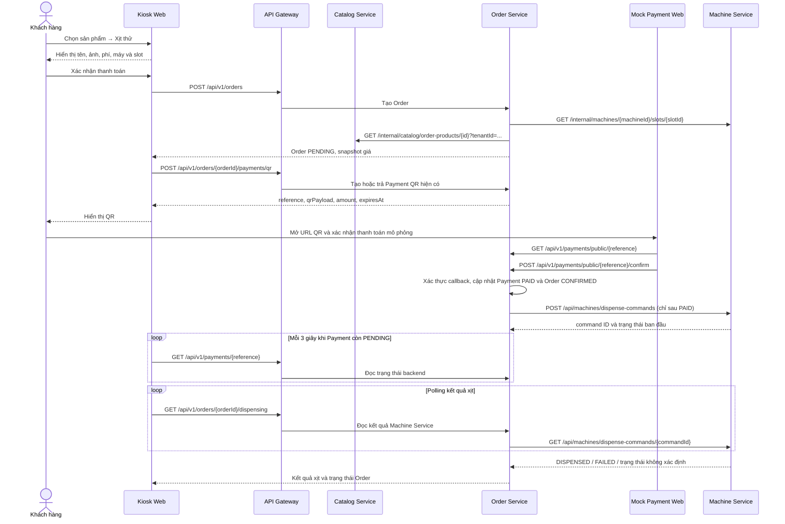

# Tích hợp Xịt thử và thanh toán QR

## 1. Mục đích

Cho phép khách chọn một sản phẩm tại Kiosk, xem và xác nhận phí xịt thử, thanh toán qua QR của Order Service, rồi chỉ yêu cầu xịt sau khi backend xác nhận thanh toán. Order chỉ được đánh dấu `DISPENSED` khi Order Service nhận được kết quả thành công từ Machine Service.

## 2. Phạm vi triển khai

Luồng tái sử dụng Catalog, Order, Machine và Mock Payment Web hiện có. Không thêm Payment Service, payment provider, API giá mới hoặc tích hợp NiFi. Kiosk chỉ tạo Order trong thao tác xác nhận; nút trên danh sách chỉ mở màn hình xác nhận.

Kiosk đang tạo Order gồm một sản phẩm và một lượt xịt. Nếu tạo QR lỗi sau khi Order đã được tạo, lần xác nhận tiếp theo đọc lại Order đó; nếu vẫn `PENDING` hoặc đã `CONFIRMED` thì dùng lại Order và API QR idempotent, nếu Order đã kết thúc thì tạo Order mới sau lần xác nhận của khách. Payment đã được xác nhận ngay khi lấy QR cũng đưa Kiosk thẳng sang theo dõi lệnh xịt.

## 3. Cấu hình giá sản phẩm của Brand Administrator

- Brand Administrator có quyền `CATALOG_MANAGE` có thể cập nhật `Product.defaultPrice` tại trang Sản phẩm. Giao diện dùng `ProductPriceForm` và API hiện có `PATCH /api/products/{id}/price`.
- Campaign được quản lý riêng qua API Campaign hiện có. Catalog tính `effectivePrice` từ `defaultPrice` và Campaign đang hiệu lực; khi có nhiều Campaign thì chọn giá thấp nhất theo logic hiện tại.
- Kiosk đọc giá hiệu lực từ `GET /api/pricing/products/{productId}?tenantId={tenantId}` để hiển thị phí thử.
- Khi tạo Order, Order Service kiểm tra snapshot sản phẩm và giá với Catalog authority rồi lưu giá đơn tại thời điểm tạo. Việc cập nhật giá sau đó không thay đổi Order đã tạo.
- `Slot.price` không được dùng làm giá sản phẩm/xịt thử.

## 4. Các thành phần tham gia

- `frontend/kiosk-web`: đăng nhập, duyệt sản phẩm/slot, xác nhận, hiển thị QR và truy vấn trạng thái thanh toán/xịt.
- Catalog Service: cung cấp Product, giá hiệu lực và snapshot giá có Campaign cho Order Service.
- Order Service: kiểm tra khách hàng/tenant, máy/slot, giá; tạo Order, QR Payment, nhận callback và điều phối xịt.
- Mock Payment Web: đọc Payment thật theo reference và gửi xác nhận qua callback có token.
- Machine Service: tiếp nhận lệnh nội bộ có command ID, trả trạng thái lệnh và kết quả máy.
- API Gateway: điểm vào cho các API ứng dụng được định tuyến qua Gateway.

## 5. Luồng Xịt thử và QR Payment



Sau khi Payment là `PAID`, backend yêu cầu xịt ngay trong quá trình xử lý callback; Kiosk chuyển sang màn hình theo dõi khi thấy trạng thái PAID. Kiosk không gửi lệnh xịt và không có API cập nhật PAID. Lệnh xịt dùng `commandId` ổn định theo Order; yêu cầu lặp lại trả về command hiện có. Timeout hoặc phản hồi không xác định được ghi nhận để rà soát, không tạo lệnh thứ hai.

## 6. Các API được sử dụng

| API | Mục đích |
|---|---|
| `POST /api/auth/login`, `GET /api/auth/me`, `POST /api/auth/logout` | Xác thực tài khoản Kiosk |
| `GET /api/products?tenantId={tenantId}` | Danh mục sản phẩm |
| `GET /api/pricing/products/{productId}?tenantId={tenantId}` | Giá hiệu lực hiển thị tại Kiosk |
| `GET /api/machines/{machineId}` và `GET /api/machines/{machineId}/slots` | Trạng thái máy và slot |
| `POST /api/v1/orders` | Tạo Order sau khi khách xác nhận; server kiểm tra snapshot Catalog và trạng thái máy/slot |
| `POST /api/v1/orders/{orderId}/payments/qr` | Tạo hoặc lấy lại QR Payment cho Order |
| `GET /api/v1/payments/{reference}` | Kiosk đọc trạng thái Payment |
| `GET /api/v1/payments/public/{reference}` | Mock Payment Web đọc giao dịch |
| `POST /api/v1/payments/public/{reference}/confirm` | Mock Payment Web gửi callback xác nhận có `X-Payment-Callback-Token` |
| `GET /api/v1/orders/{orderId}/dispensing` | Kiosk lấy trạng thái và kết quả xịt |

Order Service gọi API nội bộ Catalog để lấy snapshot giá có hiệu lực và API nội bộ Machine để kiểm tra slot. Sau khi xác nhận PAID, Order Service dùng các API nội bộ tạo và truy vấn dispense command của Machine Service.

## 7. Trạng thái Order và Payment

- Payment: `PENDING` → `PAID`, `FAILED` hoặc `EXPIRED`. Callback kiểm tra token, reference, order ID, số tiền, tiền tệ và `eventId`; callback trùng có cùng payload được xử lý idempotent. Một `eventId` dùng lại với payload khác bị từ chối.
- Order bắt đầu ở `PENDING`; callback PAID chuyển thành `CONFIRMED`, callback FAILED chuyển thành `FAILED`, và hết hạn chuyển thành `EXPIRED`.
- Kết quả lệnh: `REQUESTED`, `ACCEPTED`, `PROCESSING`, `DISPENSED`, `FAILED` hoặc `UNKNOWN`. Timeout/mất phản hồi tạo trạng thái cần rà soát; trạng thái Order không tự chuyển `DISPENSED`.
- Order chỉ chuyển thành `DISPENSED` sau khi kết quả thành công từ Machine Service. Máy báo thất bại thì Order thành `FAILED`; trạng thái hết hạn/không rõ cần rà soát thủ công.

## 8. Cách chạy và kiểm thử

Từ thư mục gốc:

```powershell
docker compose up -d --build
pwsh -File scripts/Test-ReportingIntegration.ps1
```

Build giao diện Kiosk:

```powershell
Set-Location frontend/kiosk-web
npm run build
```

Kiểm thử Order Service:

```powershell
Set-Location services/order-service
mvn test
```

Kiosk cần được cấu hình `VITE_KIOSK_MACHINE_ID`; API base URL và các biến môi trường cho Mock Payment Web cần khớp cấu hình triển khai. Mock Payment Web chỉ mô phỏng callback trong môi trường phát triển, không phải cổng thanh toán thật.

## 9. Các trường hợp lỗi đã xử lý trong source

- Order không hợp lệ, tenant/khách không khớp, sản phẩm không thuộc slot, giá khác Catalog, máy/slot không sẵn sàng: backend từ chối tạo Order.
- QR được tạo lặp cho cùng Order: trả về Payment hiện có, không sinh reference khác.
- QR hết hạn: Payment/Order hết hạn; callback muộn bị từ chối và Kiosk không gửi yêu cầu xịt.
- Callback thiếu/sai token, sai reference/order/amount/currency, sai payload khi dùng lại event ID: backend từ chối. Callback PAID lặp không tạo command dispense mới.
- Payment FAILED: Order FAILED và không tạo lệnh xịt.
- Máy lỗi, timeout hoặc kết quả không khớp: lệnh được giữ ở trạng thái lỗi/không xác định và đưa vào manual review; không đánh dấu Order đã dispense thành công.
- Máy trả kết quả DISPENSED: Order Service cập nhật Order thành `DISPENSED`.

## 10. Kết quả kiểm thử thực tế

- `frontend/kiosk-web`: `npm run build` và `npm run lint` — cả hai thành công.
- `frontend/admin-web`: `npm run build` — thành công; xác nhận màn quản lý giá hiện có vẫn build được.
- `services/order-service`: `mvn test` — thành công, 63 tests; 0 failures, 0 errors, 0 skipped. Bổ sung kiểm tra hai Order độc lập nhận hai payment reference khác nhau.
- `services/catalog-service`: `mvn -Dtest=CampaignPricingApiIntegrationTest,PromotionalPricingServiceTest test` — thành công, 8 tests; 0 failures, 0 errors, 0 skipped.
- Chưa chạy `docker compose` hoặc kiểm tra API end-to-end trên các service đang chạy; chưa kiểm thử với máy vật lý. Các test trên gồm MockMvc/integration test của backend, không chứng minh thiết bị thật đã phun.

## 11. Danh sách file đã chỉnh sửa

- `frontend/kiosk-web/src/App.tsx` — điều chỉnh polling trạng thái Payment để giữ chu kỳ 3 giây, ngăn poll chồng nhau; kiểm tra và dùng lại Order `PENDING`/`CONFIRMED` tương ứng nếu bước tạo QR cần thử lại; đổi nhãn thao tác thành “Xịt thử”.
- `services/order-service/src/test/java/com/scentstation/order/controller/PaymentControllerTest.java` — kiểm tra reference QR khác nhau giữa hai Order.
- `docs/kiosk-web/TRIAL_SPRAY_AND_QR_PAYMENT.md` — tài liệu luồng, API, trạng thái và kết quả kiểm thử.
