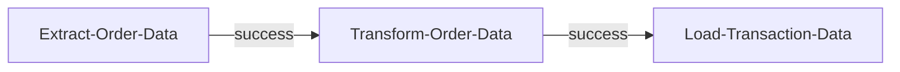

# Task 4: Design NiFi Data Flow

## 1. Mục tiêu

Thiết kế luồng Extract–Transform–Load (ETL) trên Apache NiFi cho dữ liệu đơn hàng của ScentStation. Tài liệu ghi nhận các Processor, Controller Service, Record Reader/Writer và Connection được nêu cho luồng; việc đồng bộ dữ liệu thực tế chưa được xác nhận.

## 2. Môi trường thực hiện

- Giao diện: Apache NiFi Web UI.
- Phiên bản NiFi: `2.4.0`, theo môi trường đã ghi nhận trong tài liệu Task 2.
- Không ghi thông tin xác thực hoặc mật khẩu trong tài liệu này.

## 3. Process Group

Được thiết kế một Process Group riêng có tên `ScentStation-ETL-Sync` dành cho luồng đồng bộ dữ liệu ScentStation.

## 4. Thiết kế luồng ETL

### 4.1. Extract – Trích xuất dữ liệu

- Processor: `QueryDatabaseTableRecord`
- Tên: `Extract-Order-Data`
- Nguồn: MySQL, database `order_db`, bảng `orders`
- Database Connection Pooling Service: `OrderDB-Connection-Pool`
- Record Writer: `Order-JSON-Writer`
- Maximum-value Columns: `updated_at`

Processor được thiết kế để trích xuất các bản ghi từ bảng `orders`, sử dụng `updated_at` làm cột theo dõi giá trị lớn nhất.

### 4.2. Transform – Chuyển đổi dữ liệu

- Processor: `UpdateRecord`
- Tên: `Transform-Order-Data`
- Record Reader: `Order-JSON-Reader`
- Record Writer: `Order-JSON-Writer`
- Replacement Value Strategy: `Literal Value`

Không có quy tắc RecordPath hoặc User-defined Properties cụ thể nào được xác nhận để ghi lại. Do đó, tài liệu không chỉ định thêm biểu thức hoặc giá trị chuyển đổi.

### 4.3. Load – Ghi dữ liệu

- Processor: `PutDatabaseRecord`
- Tên: `Load-Transaction-Data`
- Database đích: `scentstation_reporting`
- Bảng đích: `transactions`
- Controller Service: `ReportingDB-Connection-Pool`
- Statement Type: dự kiến `INSERT`

`INSERT` được ghi nhận là loại câu lệnh dự kiến, không phải kết quả đã xác minh từ cấu hình đang chạy. Tài liệu không khẳng định dữ liệu đã được ghi vào bảng đích hoặc cấu trúc `orders` tương thích hoàn toàn với `transactions`.

## 5. Controller Services

### `OrderDB-Connection-Pool`

- Loại: `DBCPConnectionPool`
- Driver: MySQL Connector/J `8.4.0`
- Vai trò: cung cấp kết nối từ NiFi tới Order Database cho bước Extract.
- Database Connection Pooling Service được sử dụng bởi `Extract-Order-Data`.

URL kết nối và thông tin xác thực của Order Database không được ghi ở đây vì chưa được cung cấp để xác nhận và tài liệu không chứa mật khẩu.

### `ReportingDB-Connection-Pool`

- Loại: `DBCPConnectionPool`
- Database URL dự kiến: `jdbc:mysql://reporting-db:3306/scentstation_reporting`
- Driver class: `com.mysql.cj.jdbc.Driver`
- Driver JAR: MySQL Connector/J `8.4.0`
- Database User: `reporting_app`
- Vai trò: cung cấp kết nối tới Reporting Database cho bước Load.

Database URL trên được ghi nhận là giá trị dự kiến, không phải xác nhận kết nối thành công. Mật khẩu không được đưa vào tài liệu.

### Record Writer `Order-JSON-Writer`

- Loại: `JsonRecordSetWriter`
- Schema Access Strategy: `Inherit Record Schema`
- Schema Write Strategy: `Do Not Write Schema`
- Pretty Print JSON: `false`

### Record Reader `Order-JSON-Reader`

- Loại: `JsonTreeReader`
- Schema Access Strategy: `Infer Schema`

## 6. Thiết lập Connection

Hai Connection `success` được thiết kế theo thứ tự ETL:

1. `Extract-Order-Data` → `Transform-Order-Data`, Relationship `success`.
2. `Transform-Order-Data` → `Load-Transaction-Data`, Relationship `success`.

Như vậy, luồng dự kiến lấy dữ liệu từ Order Database, chuyển qua bước Transform, rồi gửi tới Reporting Database. Không ghi nhận Connection nào khác trong tài liệu này.

## 7. Sơ đồ tổng quan Data Flow

Sơ đồ chỉ biểu diễn hai Connection `success` nêu trên; không biểu diễn nhánh `failure`.

## 8. Kết quả thực hiện

Tài liệu ghi nhận thiết kế Process Group `ScentStation-ETL-Sync`, các Processor Extract/Transform/Load, các Record Reader/Writer, hai Controller Service và trình tự Connection `success` theo thông tin được cung cấp cho Task 4.

Đây là thiết kế và cấu hình cơ bản trên giao diện NiFi. Chưa có xác nhận rằng luồng đã được chạy đồng bộ dữ liệu thực tế, kết nối đã hoạt động, hoặc dữ liệu đã được ghi thành công vào Reporting Database.

## 9. Phạm vi và giới hạn

- Chỉ ghi nhận luồng `success` được nêu trong thiết kế.
- Không triển khai hoặc mô tả nhánh xử lý `failure` hoàn chỉnh.
- Không thêm Processor ghi log lỗi hay Connection ngoài các Connection được liệt kê.
- Không tự đặt quy tắc Transform chưa được xác nhận.
- Không khẳng định schema của `orders` tương thích hoàn toàn với `transactions`.
- Các giá trị được ghi rõ là dự kiến, gồm Statement Type `INSERT` và Reporting Database URL, chưa được xác nhận là cấu hình đang hoạt động.
- Chưa xác nhận đồng bộ dữ liệu thực tế hoặc kết quả ghi dữ liệu.

## 10. Hình ảnh minh chứng

Chưa tìm thấy các ảnh dưới đây trong thư mục tài liệu khi lập tài liệu này. Đây là tên ảnh dự kiến; chưa bổ sung ảnh và không tạo ảnh thay thế:

- `T4_01_Process_Group.png` — dự kiến
- `T4_02_Extract_Configuration.png` — dự kiến
- `T4_03_Transform_Configuration.png` — dự kiến
- `T4_04_Load_Configuration.png` — dự kiến
- `T4_12_Extract_Transform_Connection.png` — dự kiến
- `T4_17_Transform_Load_Connection.png` — dự kiến
- `T4_21_Complete_ETL_Flow.png` — dự kiến
