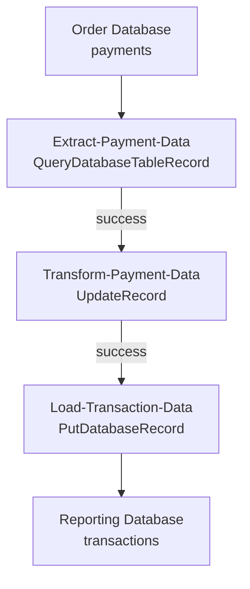

# Task 5: Implement MySQL Data Synchronization

## 1. Mục tiêu

Triển khai luồng ETL bằng Apache NiFi để đọc dữ liệu thanh toán từ MySQL `order_db`, chuẩn hóa trường `status` và đồng bộ vào `scentstation_reporting.transactions`. Trong lần kiểm thử được cung cấp, luồng đã xử lý dữ liệu, hai cơ sở dữ liệu đều có 10 bản ghi và lần chạy tiếp theo không làm tăng tổng số bản ghi đích.

## 2. Môi trường thực hiện

- Apache NiFi `2.4.0`.
- MySQL `8.4`.
- MySQL Connector/J `8.4.0`.
- Process Group: `ScentStation-ETL-Sync`.
- Nguồn: `order_db.payments`.
- Đích: `scentstation_reporting.transactions`.

## 3. Tổng quan quy trình đồng bộ dữ liệu

Luồng thực tế gồm ba Processor và hai Connection dùng Relationship `success`:



Không triển khai nhánh `failure` riêng.

## 4. Cấu hình Data Flow

### 4.1. Extract – Trích xuất dữ liệu

- Processor: `QueryDatabaseTableRecord`
- Tên: `Extract-Payment-Data`
- Database nguồn: `order_db`
- Table Name: `payments`
- Database Connection Pool: `OrderDB-Connection-Pool`
- Record Writer: `Order-JSON-Writer`
- Maximum-value Columns: để trống

Để trống Maximum-value Columns khiến Processor đọc lại toàn bộ dữ liệu `payments` trong mỗi lần chạy theo cấu hình đã triển khai. Cách này cho phép lấy lại cả các bản ghi cũ có trạng thái thay đổi, nhưng làm tăng lượng dữ liệu cần xử lý khi bảng lớn.

### 4.2. Transform – Chuyển đổi dữ liệu

- Processor: `UpdateRecord`
- Tên: `Transform-Payment-Data`
- Record Reader: `Order-JSON-Reader`
- Record Writer: `Order-JSON-Writer`
- Replacement Value Strategy: `Literal Value`
- User-defined Property:
  - RecordPath: `/status`
  - Giá trị: `${field.value:toUpper()}`

Quy tắc này chuẩn hóa giá trị `status` thành chữ in hoa.

### 4.3. Load – Ghi dữ liệu

- Processor: `PutDatabaseRecord`
- Tên: `Load-Transaction-Data`
- Database Type: `MySQL`
- Database đích: `scentstation_reporting`
- Table Name: `transactions`
- Database Connection Pool: `ReportingDB-Connection-Pool`
- Statement Type: `UPSERT`
- Update Keys: `reference`
- Translate Field Names: `false`
- Unmatched Field Behavior: `Ignore Unmatched Fields`

Mapping được cấu hình:

| Trường nguồn | Trường đích |
|---|---|
| `reference` | `reference` |
| `order_id` | `order_id` |
| `amount` | `amount` |
| `currency` | `currency` |
| `status` | `status` |
| `created_at` | `created_at` |
| `paid_at` | `paid_at` |

`qr_payload` và `expires_at` không có trong bảng đích và được bỏ qua theo cấu hình unmatched field. Trường `id` ở bảng đích do MySQL tự sinh.

## 5. Cấu hình kết nối MySQL

| Controller Service | Loại | Trạng thái | Vai trò |
|---|---|---|---|
| `OrderDB-Connection-Pool` | `DBCPConnectionPool` | `Enabled` | Kết nối tới database nguồn `order_db` |
| `ReportingDB-Connection-Pool` | `DBCPConnectionPool` | `Enabled` | Kết nối tới database đích `scentstation_reporting` |

MySQL Connector/J phiên bản `8.4.0` được sử dụng. `Order-JSON-Reader` và `Order-JSON-Writer` cũng đã ở trạng thái `Enabled`. Không ghi mật khẩu hoặc thông tin xác thực nhạy cảm.

## 6. Thiết lập và thực hiện đồng bộ

1. Đã cấu hình ba Processor trong Process Group `ScentStation-ETL-Sync` và hai Connection `success` theo sơ đồ.
2. Đã xác nhận `OrderDB-Connection-Pool`, `ReportingDB-Connection-Pool`, `Order-JSON-Reader` và `Order-JSON-Writer` ở trạng thái `Enabled`.
3. Đã Verify cả ba Processor; không có lỗi Verify trước khi Start.
4. Đã Start cả ba Processor và theo dõi trạng thái xử lý cùng các Queue trên giao diện NiFi.
5. Đã kiểm tra riêng dữ liệu trong MySQL nguồn và đích; Verify và thống kê FlowFile được đối chiếu với kết quả kiểm tra MySQL.

## 7. Kiểm tra dữ liệu nguồn và đích

### Nguồn: `order_db.payments`

Đã thực hiện:

```sql
DESCRIBE payments;
SELECT * FROM payments LIMIT 5;
```

Bảng `payments` có 10 bản ghi với các trường `reference`, `order_id`, `amount`, `currency`, `qr_payload`, `status`, `created_at`, `expires_at` và `paid_at`. Năm bản ghi mẫu được kiểm tra:

| Reference | Order ID | Status quan sát được |
|---|---:|---|
| `DEMO-PAY-91701` | 91701 | `PAID` |
| `DEMO-PAY-91702` | 91702 | `PAID` |
| `DEMO-PAY-91703` | 91703 | `PAID` |
| `DEMO-PAY-91704` | 91704 | `PENDING` |
| `DEMO-PAY-91705` | 91705 | `FAILED` |

### Đích: `scentstation_reporting.transactions`

Đã thực hiện:

```sql
SELECT COUNT(*) AS total_transactions FROM transactions;
```

Kết quả `total_transactions = 10`. Đã kiểm tra các trường `reference`, `order_id`, `amount`, `currency`, `status`, `created_at` và `paid_at`; dữ liệu có `order_id` từ `91701` đến `91710`. Các trạng thái quan sát được gồm `PAID`, `PENDING`, `FAILED` và `EXPIRED`.

Số bản ghi nguồn và đích tại thời điểm kiểm tra đều bằng 10.

### Kiểm tra bản ghi trùng

Đã thực hiện:

```sql
SELECT reference, COUNT(*) AS duplicate_count
FROM transactions
GROUP BY reference
HAVING COUNT(*) > 1;
```

Kết quả là `Empty set`. Sau lần đồng bộ tiếp theo, tổng số bản ghi đích vẫn là 10, không tăng lên 15. Trong lần kiểm thử này, `UPSERT` với Update Keys `reference` không tạo bản ghi trùng. Chưa kiểm thử cập nhật một bản ghi cũ sau khi thay đổi dữ liệu nguồn.

## 8. Theo dõi trạng thái xử lý trên NiFi

Cả ba Processor đã được Start và ở trạng thái `Running`. Tại thời điểm kiểm tra, không Processor nào hiển thị cảnh báo hoặc lỗi.

| Processor | In | Out |
|---|---:|---:|
| `Extract-Payment-Data` | 0 | 5 |
| `Transform-Payment-Data` | 5 | 5 |
| `Load-Transaction-Data` | 5 | 0 |

Hai Connection Queue sau khi xử lý đều có `0` FlowFiles. `Load-Transaction-Data` là Processor cuối luồng và không có Connection đầu ra; vì vậy, `Out = 0` không tự chứng minh mọi FlowFile đã được ghi. Kết quả trong MySQL được kiểm tra riêng ở mục 7.

## 9. Kết quả thực hiện

- Ba Processor đã Verify không báo lỗi trước khi Start và đều ở trạng thái `Running` tại thời điểm kiểm tra.
- Luồng đã xử lý qua hai Connection `success`; hai Queue đều về `0` FlowFiles.
- Bảng nguồn `payments` và bảng đích `transactions` đều có 10 bản ghi tại thời điểm đối chiếu.
- Quy tắc `UpdateRecord` được cấu hình để chuyển `status` thành chữ in hoa.
- Truy vấn duplicate trả về `Empty set`; tổng số bản ghi đích vẫn là 10 sau lần đồng bộ tiếp theo.

Kết quả chống trùng chỉ áp dụng cho lần kiểm thử này với `UPSERT` và Update Keys `reference`; chưa xác nhận hành vi cập nhật bản ghi cũ khi dữ liệu nguồn thay đổi.

## 10. Giới hạn và phạm vi chưa triển khai

- Chưa kiểm thử cập nhật một bản ghi cũ sau khi thay đổi dữ liệu ở nguồn.
- Không triển khai nhánh `failure` riêng.
- Chưa xác nhận cơ chế retry hoặc xử lý lỗi riêng.
- Chưa kiểm thử mọi trường hợp lỗi; không kết luận luồng đã xử lý đầy đủ mọi tình huống.
- Do Maximum-value Columns để trống, toàn bộ bảng `payments` được đọc lại mỗi lần chạy; lượng dữ liệu xử lý có thể tăng khi bảng lớn.
- Kiểm tra chống trùng chỉ được xác nhận trong lần kiểm thử nêu trên; không khẳng định mọi tình huống đều không phát sinh trùng.

## 11. Hình ảnh minh chứng

Chưa tìm thấy tệp ảnh minh chứng Task 5 trong `docs/nifi/`. Các ảnh dưới đây cần bổ sung nếu có; danh sách này không khẳng định ảnh đã tồn tại và không thay thế cho kết quả kiểm thử:

- `T5_01_Complete_Data_Flow.png` — toàn bộ Data Flow với ba Processor và hai Connection `success`.
- `T5_02_FlowFile_Statistics_And_Queues.png` — thống kê In/Out của Processor và Queue.
- `T5_03_Payments_Schema_And_Source_Data.png` — cấu trúc bảng `payments` và dữ liệu nguồn.
- `T5_04_Load_Upsert_Configuration.png` — cấu hình MySQL, `UPSERT` và Update Keys `reference`.
- `T5_05_Transactions_After_Sync.png` — dữ liệu bảng `transactions` sau đồng bộ.
- `T5_06_Duplicate_Check_Empty_Set.png` — truy vấn duplicate trả về `Empty set`.
- `T5_07_Source_Target_Counts.png` — đối chiếu số lượng nguồn và đích đều bằng 10.
