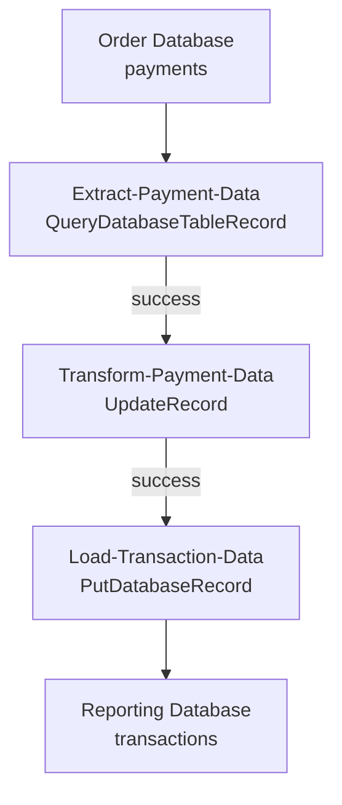

# Task 6: Test and Document NiFi Integration

## 1. Mục tiêu

Tổng hợp kết quả kiểm thử và tài liệu kỹ thuật cho tích hợp Apache NiFi với MySQL của ScentStation, dựa trên tài liệu Task 1–5 và kết quả Task 5 đã được cung cấp. Task 6 không chạy lại kiểm thử, không thay đổi dữ liệu, code hoặc cấu hình.

## 2. Phạm vi kiểm thử và tài liệu

Phạm vi Task 6 là tổng kết luồng thanh toán `payments` → `transactions`, kết quả kiểm tra MySQL và trạng thái quan sát trên NiFi. Các kết quả bên dưới được tổng hợp từ tài liệu và thông tin Task 5; không phải kết quả do Task 6 thực thi lại.

Không thực hiện thay đổi code, schema, cấu hình NiFi/MySQL hoặc dữ liệu. Các trường hợp chưa có bằng chứng được đánh dấu `Not Tested`, không xem là `Passed`.

## 3. Môi trường kiểm thử

- Apache NiFi: `2.4.0`.
- MySQL: `8.4`.
- MySQL Connector/J: `8.4.0`.
- Process Group: `ScentStation-ETL-Sync`.
- Database/bảng nguồn: `order_db.payments`.
- Database/bảng đích: `scentstation_reporting.transactions`.

## 4. Tổng quan quy trình tích hợp

Data Flow được kiểm thử gồm ba Processor và hai Connection dùng Relationship `success`:

Không có nhánh `failure` riêng trong luồng được mô tả.

## 5. Tổng hợp cấu hình triển khai

- **Extract:** `Extract-Payment-Data` đọc bảng `payments` qua `OrderDB-Connection-Pool`, dùng `Order-JSON-Writer`; Maximum-value Columns để trống nên đọc lại toàn bộ bảng mỗi lần chạy.
- **Transform:** `Transform-Payment-Data` dùng `UpdateRecord`, `Order-JSON-Reader`, `Order-JSON-Writer` và Replacement Value Strategy `Literal Value`. Quy tắc `/status = ${field.value:toUpper()}` chuẩn hóa `status` thành chữ in hoa.
- **Load:** `Load-Transaction-Data` ghi vào `scentstation_reporting.transactions` qua `ReportingDB-Connection-Pool`, dùng Database Type `MySQL`, Statement Type `UPSERT`, Update Keys `reference`. Các trường không có ở đích được bỏ qua; `id` do MySQL tự sinh.
- **Controller Services:** `OrderDB-Connection-Pool` và `ReportingDB-Connection-Pool` ở trạng thái `Enabled`. `Order-JSON-Reader` và `Order-JSON-Writer` cũng đã `Enabled`. Không ghi thông tin xác thực.

## 6. Kịch bản và kết quả kiểm thử

| Mã kiểm thử | Nội dung kiểm thử | Cách kiểm tra hoặc bằng chứng | Kết quả thực tế | Trạng thái |
|---|---|---|---|---|
| TC01 | Luồng Extract–Transform–Load | Theo dõi thống kê ba Processor và hai Queue trên NiFi | Dữ liệu đi qua ba Processor; hai Queue sau xử lý có `0` FlowFiles. Kết quả ghi được đối chiếu riêng ở TC06. | Passed |
| TC02 | Kiểm tra dữ liệu nguồn và đích sau đồng bộ | Đếm bản ghi ở `order_db.payments` và `scentstation_reporting.transactions` | Nguồn có 10 bản ghi, đích có 10 bản ghi. Không khẳng định riêng một bản ghi mới được thêm trong lúc chạy. | Passed — trong phạm vi đối chiếu số lượng |
| TC03 | Cập nhật bản ghi đã tồn tại | Cần thay đổi một bản ghi nguồn rồi chạy đồng bộ lại và xác minh giá trị ở đích | Chưa thực hiện phép thử này. | Not Tested |
| TC04 | Chống ghi trùng | Chạy đồng bộ tiếp theo; truy vấn nhóm theo `reference` và tìm nhóm có số lượng lớn hơn 1 | Kết quả duplicate là `Empty set`; tổng số bản ghi đích vẫn là 10. | Passed — trong phạm vi lần kiểm thử này |
| TC05 | Gián đoạn kết nối MySQL | Cần thử ngắt kết nối và quan sát hành vi phục hồi | Chưa thực hiện. | Not Tested |
| TC06 | Kiểm tra dữ liệu nguồn và đích | `DESCRIBE payments`, đọc 5 bản ghi mẫu; đếm và truy vấn các trường đích | Nguồn và đích đều có 10 bản ghi; các trường đích được truy vấn có dữ liệu. | Passed — về số lượng và các trường đã kiểm tra |
| TC07 | Theo dõi Processor và FlowFile | Quan sát trạng thái Processor, In/Out và Queue trên NiFi | Cả ba Processor `Running`; hai Queue bằng `0`; tại thời điểm kiểm tra không thấy cảnh báo hoặc lỗi. | Passed |

`Passed` chỉ áp dụng cho phạm vi và bằng chứng nêu trong từng dòng; không biểu thị mọi tình huống dữ liệu hoặc lỗi đã được kiểm thử.

## 7. Kết quả đối chiếu dữ liệu

- `order_db.payments`: 10 bản ghi.
- `scentstation_reporting.transactions`: 10 bản ghi.
- Dữ liệu đích có `order_id` từ `91701` đến `91710`; các trạng thái quan sát được gồm `PAID`, `PENDING`, `FAILED` và `EXPIRED`.
- Các trường đích được kiểm tra: `reference`, `order_id`, `amount`, `currency`, `status`, `created_at` và `paid_at`.
- Truy vấn tìm `reference` trùng trả về `Empty set`; sau lần đồng bộ tiếp theo, số bản ghi đích vẫn là 10.

Đối chiếu số lượng và các trường đã truy vấn xác nhận kết quả trong lần kiểm thử này, không chứng minh tính đúng đắn của mọi bản ghi hoặc mọi lần chạy.

## 8. Các vấn đề và giới hạn

- Chưa kiểm thử cập nhật một bản ghi cũ ở nguồn rồi đồng bộ lại.
- Chưa kiểm thử gián đoạn kết nối MySQL hoặc các tình huống lỗi xử lý dữ liệu riêng.
- Không có nhánh `failure` riêng; chưa xác nhận cơ chế retry hoặc xử lý lỗi riêng.
- Không kết luận các trường hợp chưa thử đã Passed.
- Extract đọc lại toàn bộ bảng `payments` mỗi lần chạy; lượng dữ liệu xử lý có thể tăng khi bảng lớn.
- Tài liệu yêu cầu Task 1 xác định `payments` → `transactions` là luồng không nên sao chép bằng NiFi trong vận hành thông thường do đã có cơ chế đồng bộ Order → Reporting. Task 5 ghi nhận một lần triển khai và kiểm thử NiFi cho dữ liệu này. Báo cáo này tổng hợp kết quả kiểm thử, không suy ra rằng đề xuất Task 1 đã được thay đổi hoặc rằng luồng NiFi được phê duyệt thay thế tích hợp hiện hữu.

## 9. Tổng kết và đánh giá

Trong lần kiểm thử được ghi nhận, luồng ETL cơ bản đã chạy qua ba Processor; dữ liệu được kiểm tra ở MySQL đích; số lượng nguồn và đích đều là 10; kiểm tra chống trùng theo `reference` trả về `Empty set` và số lượng đích không tăng sau lần đồng bộ tiếp theo. Trạng thái Processor, thống kê FlowFile và Queue cũng đã được quan sát.

Kết quả trên không bao gồm kiểm thử cập nhật bản ghi cũ, gián đoạn kết nối hay các tình huống lỗi riêng. Các kịch bản đó tiếp tục ở trạng thái `Not Tested`.

## 10. Tài liệu kỹ thuật liên quan

- [Task 1 – Yêu cầu đồng bộ dữ liệu](./data-synchronization-requirements.md)
- [Task 2 – Setup Apache NiFi Environment](./task-2-setup-apache-nifi-environment.md)
- [Task 3 – Configure MySQL Connectivity](./task-3-configure-mysql-connectivity.md)
- [Task 4 – Design NiFi Data Flow](./task-4-design-nifi-data-flow.md)
- [Task 5 – Implement MySQL Data Synchronization](./task-5-implement-mysql-data-synchronization.md)

## 11. Hình ảnh minh chứng

Chưa tìm thấy ảnh minh chứng trong `docs/nifi/`. Các ảnh dưới đây cần bổ sung nếu có; đây là nội dung dự kiến, không phải tệp ảnh hiện có:

- Toàn bộ Data Flow trên NiFi, thể hiện ba Processor và hai Connection `success`.
- Thống kê In/Out của các Processor và trạng thái hai Queue.
- Cấu hình `Load-Transaction-Data` với `UPSERT` và Update Keys `reference`.
- Cấu trúc bảng `payments` và dữ liệu nguồn.
- Dữ liệu bảng `transactions` sau đồng bộ.
- Kết quả truy vấn duplicate trả về `Empty set`.
- Kết quả đối chiếu số lượng nguồn và đích đều bằng 10.
