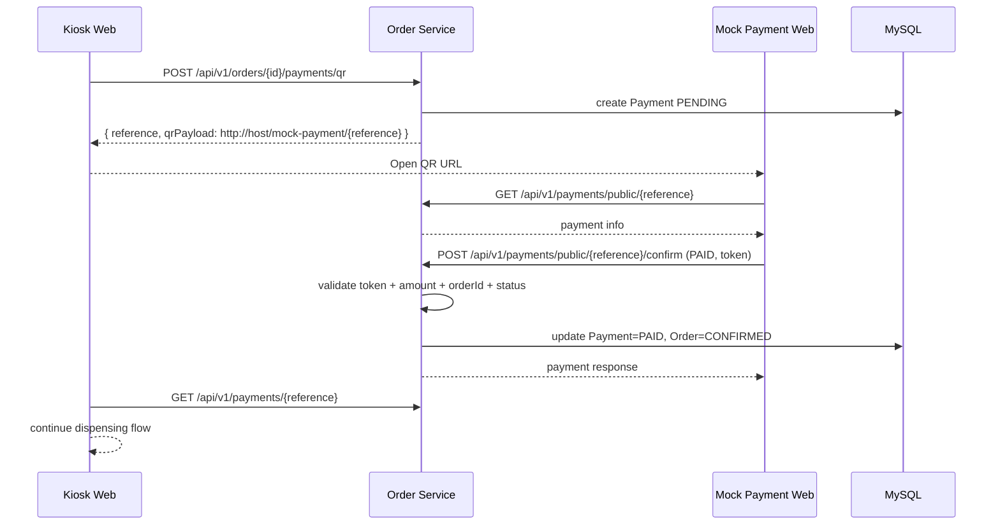

# QR Payment Implementation

## 1. Mục đích chức năng QR Payment

Chức năng QR Payment trong ScentStation nhằm mô phỏng quy trình thanh toán dành cho kiosk và khách hàng trên điện thoại. Kiosk tạo đơn hàng, Order Service tạo payment ở trạng thái PENDING, trả về URL HTTP có thể quét bằng điện thoại, và Mock Payment Web xác nhận thanh toán qua callback được kiểm tra với token và idempotency.

Mục tiêu là demo trực tiếp: không sử dụng ngân hàng thật, không giao dịch tiền thật và không tích hợp provider ngoài. Tất cả đều là mô phỏng như trong hệ thống học tập.

## 2. Phạm vi chức năng và giới hạn mô phỏng

- Tạo payment QR theo đơn hàng đang ở trạng thái PENDING.
- QR chứa URL HTTP, không dùng custom scheme như `scentstation://...`.
- Mock Payment Web chỉ hiển thị thông tin thanh toán và cho phép xác nhận.
- Order Service chịu trách nhiệm xác minh callback, so sánh số tiền, kiểm tra orderId, currency và trạng thái, cập nhật Payment/Order.
- Giao diện mobile chỉ là mock UI để demo, không thay thế nghiệp vụ thanh toán thực.
- Không tạo hoặc sửa dữ liệu đơn hàng ở frontend; mọi thay đổi trạng thái đều phải đi qua backend.

## 3. Kiến trúc các thành phần tham gia

- `frontend/kiosk-web`: tạo đơn, gọi API tạo payment, hiển thị QR code và polling trạng thái.
- `frontend/mock-payment-web`: trang thanh toán mở từ điện thoại, gọi API public của Order Service để xem thông tin và xác nhận.
- `services/order-service`: nguồn dữ liệu chính cho `Payment`, callback verification, order confirmation, dispensing trigger.
- `services/api-gateway`: điểm vào chính khi triển khai thực tế; hiện tại mock payment page có thể trực tiếp gọi Order Service bằng URL cấu hình.

```mermaid
flowchart LR
  Kiosk[frontend/kiosk-web] -->|POST /api/v1/orders/{id}/payments/qr| OS[services/order-service]
  OS -->|saves Payment PENDING| DB[(MySQL)]
  Kiosk -->|QR URL| Phone[Mock Payment Web on phone]
  Phone -->|GET /api/v1/payments/public/{reference}| OS
  Phone -->|POST /api/v1/payments/public/{reference}/confirm| OS
  OS -->|verify token + validate callback| Order[Order + Payment state]
  Order -->|confirmOrderAfterPayment| Dispense[Dispensing service]
```

## 4. Vai trò của Kiosk Web

Kiosk Web không chứa logic thanh toán nghiệp vụ. Nó:

- đăng nhập và tạo order;
- gọi `POST /api/v1/orders/{orderId}/payments/qr`;
- hiển thị QR code từ `payment.qrPayload`;
- polling `GET /api/v1/payments/{reference}` cho trạng thái PENDING/PAID/FAILED/EXPIRED;
- khi payment được thanh toán, Kiosk tiếp tục theo flow hiện có: xác nhận order và xử lý xịt.

## 5. Vai trò của Order Service

Order Service là source of truth cho thanh toán mô phỏng:

- tạo payment nếu chưa có cho order;
- kiểm tra hết hạn QR/order;
- lưu `Payment` với reference và payload URL;
- nhận callback qua `POST /api/v1/payments/callback` hoặc `POST /api/v1/payments/public/{reference}/confirm`;
- xác thực token, compare amount/orderId/currency;
- cập nhật `PaymentStatus` và `OrderStatus` theo các quy tắc hiện có;
- không cho phép callback trùng lặp / payload khác nhau với cùng eventId.

## 6. Vai trò của Mock Payment Web

Mock Payment Web là interface trên điện thoại, không phải Payment Service mới. Nó:

- đọc reference từ URL path;
- gọi public API của Order Service để hiển thị orderId, amount, status;
- khi người dùng nhấn "Xác nhận thanh toán", gửi `PAID` callback tới backend với token.
- không tự tạo hoặc điều khiển trạng thái đơn hàng; chỉ gửi callback tới backend với payload xác thực.

## 7. Luồng hoạt động từ lúc tạo đơn đến khi thanh toán thành công

1. Kiosk tạo order bằng API hiện có.
2. Kiosk gọi `POST /api/v1/orders/{orderId}/payments/qr`.
3. Order Service tạo `Payment` mới với trạng thái `PENDING` và `qrPayload` là URL HTTP như `http://HOST:PORT/mock-payment/{reference}`.
4. Kiosk hiển thị QR code chứa URL đó.
5. Khách hàng quét QR trên điện thoại.
6. Mock Payment Web đọc `reference` từ URL và fetch `GET /api/v1/payments/public/{reference}`.
7. Khách hàng nhấn xác nhận.
8. Mock Payment Web gửi callback `POST /api/v1/payments/public/{reference}/confirm` với `X-Payment-Callback-Token`.
9. Backend kiểm tra token, orderId, amount, currency, trạng thái payment.
10. Order Service gọi flow xác nhận order và trigger dispensing.
11. Kiosk polling nhận trạng thái `PAID`/`CONFIRMED` và tiếp tục luồng xịt hương.



## 8. Luồng callback và cách backend xác nhận thanh toán

Backend xử lý callback bằng `PaymentService.processCallback(...)`.

Các bước xác thực chính:

- kiểm tra `X-Payment-Callback-Token`; nếu thiếu hoặc sai -> `401`.
- nếu `eventId` đã sử dụng, kiểm tra payload; nếu khác payload -> `409`.
- kiểm tra payment reference tồn tại.
- kiểm tra `orderId` khớp với payment.
- kiểm tra số tiền và currency khớp với order.
- nếu payment đã hết hạn hoặc FAILED, từ chối callback.
- nếu status là `FAILED`, fail order theo flow hiện có.
- nếu status là `PAID`, confirm order, mark payment as paid, request dispensing.
- duplicate callback luôn được xử lý idempotently.

## 9. Danh sách API sử dụng

- `POST /api/v1/orders/{orderId}/payments/qr` — tạo hoặc đọc payment cho order.
- `GET /api/v1/payments/{reference}` — lấy trạng thái payment (authenticated flow).
- `GET /api/v1/payments/public/{reference}` — lấy payment không cần JWT, phục vụ mock payment page trên điện thoại.
- `POST /api/v1/payments/public/{reference}/confirm` — callback public cho mock payment web.
- `POST /api/v1/payments/callback` — callback server-to-server / provider simulation.
- `POST /api/v1/payments/{reference}/simulate` — demo-only successful payment.
- `GET /api/v1/orders/{id}/status` — status order và confirm.
- `GET /api/v1/orders/{id}/dispensing` — kiểm tra kết quả xịt.

## 10. Cấu trúc thư mục và các file đã thêm hoặc sửa

### File đã sửa

- `services/order-service/src/main/java/com/scentstation/order/service/PaymentService.java`
- `services/order-service/src/main/java/com/scentstation/order/controller/PaymentController.java`
- `services/order-service/README.md`
- `docker-compose.yml`
- `README.md`

### File mới

- `frontend/mock-payment-web/package.json`
- `frontend/mock-payment-web/index.html`
- `frontend/mock-payment-web/vite.config.ts`
- `frontend/mock-payment-web/tsconfig.json`
- `frontend/mock-payment-web/tsconfig.app.json`
- `frontend/mock-payment-web/tsconfig.node.json`
- `frontend/mock-payment-web/.env.example`
- `frontend/mock-payment-web/src/main.tsx`
- `frontend/mock-payment-web/src/App.tsx`
- `frontend/mock-payment-web/src/index.css`
- `infra/docker/mock-payment-web.Dockerfile`
- `docs/qrpayment/QR_PAYMENT_IMPLEMENTATION.md`

## 11. Các biến môi trường và cấu hình cần thiết

### Order Service

- `PAYMENT_QR_EXPIRATION`: thời gian hiệu lực QR, mặc định `PT15M`.
- `PAYMENT_CALLBACK_TOKEN`: token xác thực callback, mặc định `local-mock-callback-token`.
- `PAYMENT_MOCK_WEB_BASE_URL`: public URL gốc của mock payment web, ví dụ `http://192.168.1.10:3000/mock-payment`.

### Mock Payment Web

- `VITE_ORDER_SERVICE_URL`: URL gốc của Order Service, ví dụ `http://192.168.1.20:8083`.
- `VITE_PAYMENT_CALLBACK_TOKEN`: token callback tương ứng với backend.
- `VITE_MOCK_PAYMENT_WEB_BASE_URL`: URL của trang payment (nếu cần hiển thị hoặc share).

## 12. Hướng dẫn chạy bằng Docker

1. Cấu hình biến môi trường nếu cần:
   ```bash
   export PAYMENT_MOCK_WEB_BASE_URL=http://192.168.1.10:3000/mock-payment
   export PAYMENT_CALLBACK_TOKEN=local-mock-callback-token
   export ORDER_SERVICE_URL=http://192.168.1.10:8083
   ```
2. Khởi động stack:
   ```bash
   docker compose up -d --build
   ```
3. Truy cập:
   - Order Service: `http://localhost:8083/swagger-ui.html`
   - Mock Payment Web: `http://localhost:3000/mock-payment/PAY-<REFERENCE>`

Lưu ý: để điện thoại quét được trên LAN, `PAYMENT_MOCK_WEB_BASE_URL` phải là địa chỉ IP LAN hoặc hostname có thể truy cập từ thiết bị đó, không phải `localhost`.

## 13. Hướng dẫn chạy thử bằng máy tính và điện thoại

### Trên PC / laptop

- Tạo order từ Kiosk Web hoặc gọi API `POST /api/v1/orders`.
- Gọi `POST /api/v1/orders/{id}/payments/qr`.
- Nhận `qrPayload` như `http://192.168.1.10:3000/mock-payment/PAY-...`.
- Quét QR bằng điện thoại hoặc mở URL trực tiếp trên browser.

### Trên điện thoại

- Kết nối cùng mạng LAN với máy chạy repo.
- Mở URL được sinh ra trong QR.
- Xem thông tin đơn hàng.
- Nhấn "Xác nhận thanh toán".
- Backend sẽ cập nhật trạng thái thanh toán và order, đồng thời Kiosk có thể polling trạng thái để tiếp tục flow.

## 14. Cách cấu hình IP LAN để quét QR

Set `PAYMENT_MOCK_WEB_BASE_URL` theo địa chỉ IP LAN của máy host, ví dụ:

```bash
PAYMENT_MOCK_WEB_BASE_URL=http://192.168.1.10:3000/mock-payment
ORDER_SERVICE_URL=http://192.168.1.10:8083
```

Sau đó restart stack và quét QR từ điện thoại đang cùng subnet. Nếu là môi trường không ở cùng mạng, cần đặt hostname hoặc reverse proxy tương ứng.

## 15. Các trạng thái Payment và Order

- Payment: `PENDING`, `PAID`, `FAILED`, `EXPIRED`.
- Order: `PENDING`, `CONFIRMED`, `CANCELLED`, `EXPIRED`, etc. theo logic hiện có trong project.
- Khi payment đã PAID, Order Service chuyển trạng thái order theo flow confirmation và request dispensing.

## 16. Các trường hợp lỗi và cách xử lý

- `Payment reference không tồn tại`: `404`.
- `Order không tồn tại`: `404` khi tạo/routing payment.
- `Số tiền không khớp`: `400`.
- `Token không hợp lệ`: `401`.
- `Callback trùng lặp`: idempotent logic trả về trạng thái hiện có thay vì xử lý lại.
- `Payment đã PAID`: callback mới với trạng thái khác -> `409`.
- `Payment đã hết hạn`: callback reject, order bị expire.

## 17. Các biện pháp bảo vệ API thanh toán mô phỏng

- Token `X-Payment-Callback-Token` bắt buộc cho callback endpoints.
- Kiểm tra `orderId`, `reference`, `amount`, `currency`.
- Reject callback nếu eventId đã dùng với payload khác nhau.
- Không cho phép tham số orderId sai với payment reference.
- Không để frontend tự cập nhật trạng thái thanh toán; chỉ backend có quyền xác nhận.

## 18. Những phần đã hoàn thành

- QR payload không còn là custom scheme.
- Mock Payment Web đã được thêm vào frontend.
- Order Service có API public để đọc payment và xử lý xác nhận từ mock payment web.
- Docker Compose hỗ trợ port mock web.
- Tài liệu QR Payment đã được tạo tại `docs/qrpayment/QR_PAYMENT_IMPLEMENTATION.md`.

## 19. Những phần chưa hoàn thành hoặc còn giới hạn

- Đây là mock flow cho demo học tập, không phải gateway thanh toán thật.
- Trường hợp trên điện thoại không cùng mạng LAN cần cấu hình IP riêng theo môi trường triển khai.
- Kiosk và mock page chỉ demo đúng luồng backend; chưa tích hợp với provider thực tế.

## 20. Kết quả kiểm thử thực tế

- Đã cập nhật Order Service để sinh URL HTTP cho QR payload.
- Đã bổ sung public API cho web mock payment.
- Đã chạy build frontend và build backend sau khi chỉnh sửa để xác minh code còn compile đúng.
