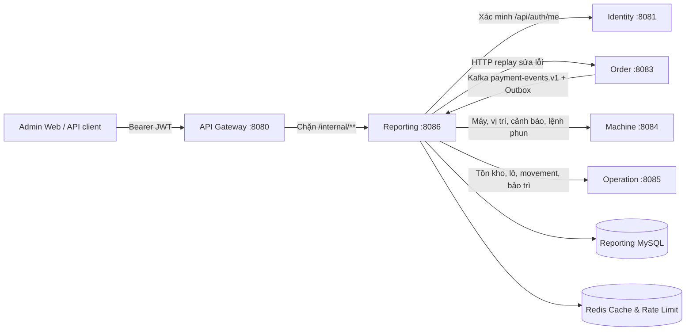

# Tích hợp Reporting Service & Hướng dẫn Admin Web

Reporting Service chạy ở cổng `8086`, dùng MySQL riêng (`scentstation_reporting`),
Redis cache/rate-limit và nhận sự kiện thanh toán từ Kafka (`payment-events.v1`).
Mọi API cho Admin Web đi qua **API Gateway** ở cổng `8080`.
Đặc tả OpenAPI đầy đủ nằm tại [contracts/openapi/reporting-service.yaml](../contracts/openapi/reporting-service.yaml).



## 1. Luồng dữ liệu & đồng bộ

- **Thanh toán (Order → Reporting):** Order ghi outbox trong cùng transaction và phát
  sự kiện lên Kafka `payment-events.v1`. Reporting lưu bản sao theo `reference` (unique +
  pessimistic lock), đảm bảo idempotent, hỗ trợ chuyển trạng thái `PENDING -> PAID -> REFUNDED`
  và tự đẩy bản ghi lỗi vào `payment-events.v1.DLT` sau khi hết retry.
- **Replay thủ công:** Dùng `POST http://localhost:8086/api/reporting/internal/transactions/sync-from-order/{reference}`
  kèm `X-Internal-Api-Key`. API Gateway (`GatewayTrustBoundaryFilter`) tự động chặn mọi
  đường dẫn chứa `/internal/` (`403 Forbidden`).
- **Dữ liệu vận hành (Machine & Operation):** Reporting đọc read-only qua HTTP GET với
  timeout kết nối 3s / đọc 5s, không can thiệp DB hay nghiệp vụ của service nguồn.

## 2. Xác thực & kiểm soát phạm vi (Tenant / Machine / Location)

- Mọi endpoint `/api/reporting/**` (trừ `/api/reporting/health` và `/api/reporting/internal/**`)
  yêu cầu `Authorization: Bearer <token>`.
- Reporting xác minh trực tiếp qua Identity `/api/auth/me`, không tin header giả mạo
  `X-Verified-*` hay claim chưa xác minh.
- **Quyền:**
  - `REPORT_READ`: `PLATFORM_SUPER_ADMIN`, `BRAND_ADMIN`, `OPERATIONS_MANAGER`, `INVENTORY_STAFF`.
  - `REPORT_EXPORT`: `PLATFORM_SUPER_ADMIN`, `BRAND_ADMIN`.
  - `PLATFORM_REPORT_READ`: chỉ `PLATFORM_SUPER_ADMIN`.
- **Chống vượt quyền tenant:** Tài khoản non-platform tự động bị khóa theo `actor.tenantId()`.
  Truyền `tenantId` khác hoặc nhiều `tenantId` trả về `403`. Xem trực tiếp giao dịch ngoài
  tenant trả `404`. Trên `/api/reporting/operations` và `/api/reporting/export/operations`,
  nếu tài khoản có giới hạn `machineIds`/`locationIds`, dữ liệu tự động lọc trong allowlist.

## 3. Hướng dẫn tích hợp với Admin Web

1. **Gọi qua Gateway (`http://localhost:8080/api/reporting/...`)** kèm `Authorization: Bearer <accessToken>`.
2. **Trang Dashboard (`/api/reporting/dashboard?period=month`):**
   - Đọc `access.scope`, `access.tenantId`, `access.canReadFinancialReports`, `access.canExport`
     để bật/tắt UI (quyền thực tế vẫn do server kiểm soát).
   - Luôn kiểm tra map `upstream` (`ok`, `local-copy`, `unavailable`, `skipped-*`) trước khi
     hiển thị số `0` như dữ liệu đã xác nhận.
3. **Trang Doanh thu & Giao dịch:**
   - Tổng quan kỳ: `GET /api/reporting/transactions/summary?period=day|week|month|custom&startDate=&endDate=`
   - Biểu đồ theo ngày: `GET /api/reporting/revenue/details?startDate=&endDate=`
   - Phân bổ theo thương hiệu/máy/sản phẩm: `GET /api/reporting/revenue/breakdown?startDate=&endDate=`
   - Tỷ lệ trạng thái: `GET /api/reporting/transactions/status-summary?startDate=&endDate=`
   - Hoàn tiền: `GET /api/reporting/refunds/summary` và `GET /api/reporting/refunds`
   - Tìm kiếm phân trang: `GET /api/reporting/transactions?page=0&size=20&sortBy=createdAt&direction=desc`
4. **Trang Báo cáo vận hành, tồn kho & sự cố (`/api/reporting/operations`):**
   - Hỗ trợ bộ lọc `period`, `startDate`, `endDate`, `tenantId`, `machineId`, `locationId`, `productId`, `refillThreshold`.
   - Trả về đầy đủ `machines`, `sprays` (gồm `paidOrderIdsWithoutSprayConfirmation`, `successRateByLocation`, `dailyTrend`),
     `inventory` (gồm `stockByMachineSlot`, `dailyConsumption`, `adjustmentHistory`, `abnormalConsumptions`, `refillCandidates`),
     và `incidents` (gồm `overdueMaintenanceTickets`, MTTR theo máy/vị trí, `alertDowntimeHours`, `downtimeHours`).
5. **Tải báo cáo Excel / CSV (yêu cầu `REPORT_EXPORT`):**
   - `GET /api/reporting/export/transactions?format=xlsx|csv`
   - `GET /api/reporting/export/revenue?startDate=&endDate=&format=xlsx|csv`
   - `GET /api/reporting/export/operations?period=month&format=xlsx|csv`
   - Đọc `Blob` từ response và lưu file theo header `Content-Disposition`.

## 4. Chạy kiểm thử

```powershell
mvn -f .\services\reporting-service\pom.xml clean verify
```

Chi tiết kỹ thuật và Postman collection xem tại [services/reporting-service/README.md](../services/reporting-service/README.md).
