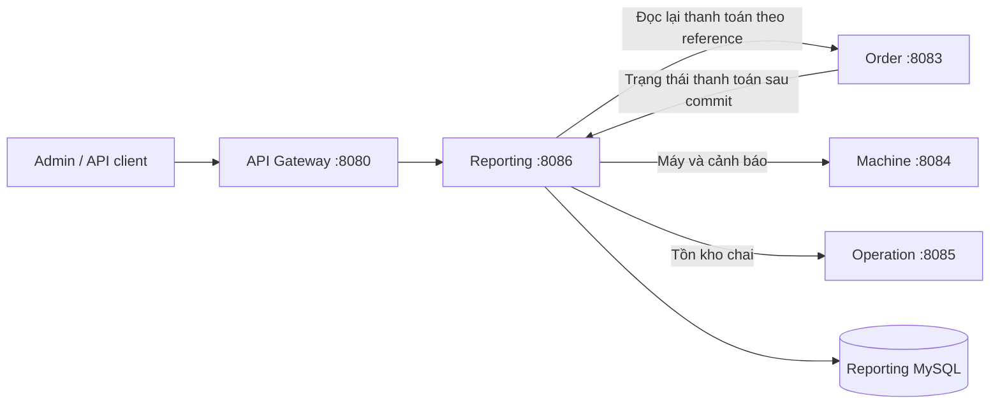

# Tích hợp Reporting Service

Reporting chạy ở cổng 8086, có MySQL riêng và giao tiếp với các service khác qua HTTP.
Các API dành cho giao diện đi qua API Gateway ở cổng 8080.



## Chạy tại máy phát triển

Từ thư mục gốc dự án:

```powershell
docker compose up -d --build
pwsh -File scripts/Test-ReportingIntegration.ps1
```

Script tạo một đơn hàng và thanh toán mẫu. Nó kiểm tra cùng một bản ghi Reporting
chuyển từ `PENDING` sang `PAID`, đọc lại thanh toán từ Order không tạo bản ghi trùng,
dashboard truy cập được Machine/Operation, và API đồng bộ nội bộ yêu cầu API key.

Dashboard:

```text
GET http://localhost:8080/api/reporting/dashboard?tenantId=1&period=day
GET http://localhost:8080/api/reporting/transactions/summary?period=month
GET http://localhost:8080/api/reporting/transactions
```

## Luồng dữ liệu

Order gửi payment reference, order ID, số tiền, tiền tệ, trạng thái và thời gian
sang `POST /api/reporting/internal/transactions/sync`. Khi có Spring transaction,
Order chỉ gửi sau commit; rollback không gửi. Reporting dùng reference làm khóa
duy nhất để cập nhật bản sao thanh toán và từ chối dữ liệu xung đột.

API nội bộ kiểm tra header `X-Internal-Api-Key`. Biến `REPORTING_SYNC_API_KEY`
phải giống nhau ở Order và Reporting. Gateway không định tuyến đường dẫn nội bộ.
Compose chỉ mở cổng Reporting trực tiếp trên loopback để hỗ trợ kiểm tra và đồng bộ lại.

Dashboard đọc doanh thu từ MySQL Reporting, còn máy, cảnh báo và tồn kho được lấy
qua HTTP. Trường `upstream` cho biết nguồn nào đang lỗi hoặc chưa được truy vấn.
Mỗi HTTP client có giới hạn thời gian kết nối và đọc phản hồi.

## Khi đồng bộ thất bại

Thanh toán vẫn được lưu ở Order nếu Reporting không truy cập được. Hiện chưa có
outbox hoặc cơ chế tự động gửi lại; có thể đồng bộ lại từng reference:

```powershell
$headers = @{ 'X-Internal-Api-Key' = 'local-reporting-sync-key' }
Invoke-RestMethod -Method Post -Headers $headers `
  'http://localhost:8086/api/reporting/internal/transactions/sync-from-order/PAY-REFERENCE'
```

Thay reference và API key bằng giá trị đang sử dụng. Kiểm tra log bằng
`docker compose logs order-service reporting-service`.

## Giới hạn hiện tại

- Báo cáo thanh toán tổng hợp toàn bộ dữ liệu Reporting; `tenantId` trên dashboard
  chỉ lọc dữ liệu Machine/Operation. Chưa dùng doanh thu này làm báo cáo riêng cho từng tenant.
- Operation yêu cầu tenant ID là số dương; nên dùng cùng ID này khi tạo dữ liệu máy.
- API báo cáo hiện cho phép truy cập theo cấu hình phát triển của dự án; cần bổ sung
  xác thực và phân quyền tenant trước khi mở ra môi trường công khai.
- Khóa mặc định trong Compose dành cho phát triển tại máy.

Chi tiết tìm kiếm, báo cáo và xuất Excel: [Reporting README](../services/reporting-service/README.md).
